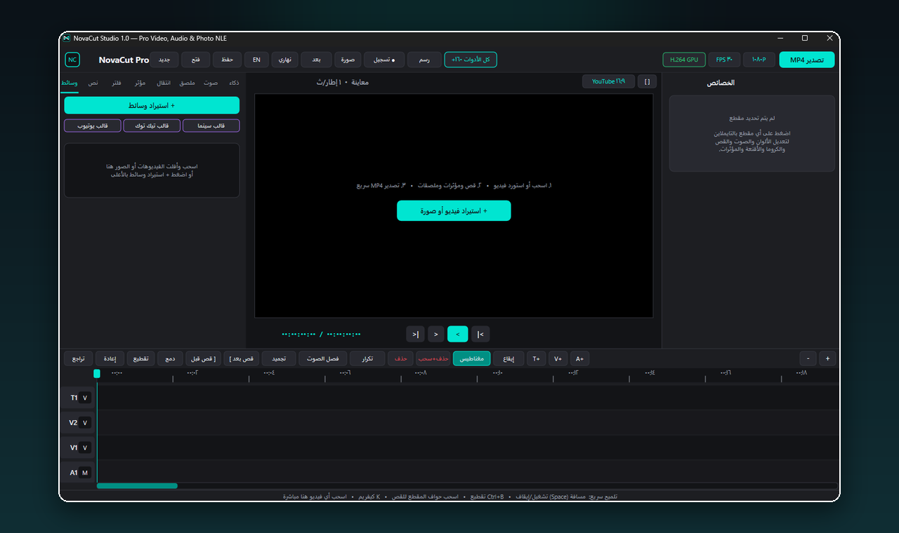
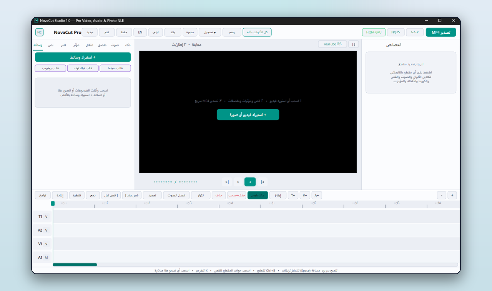
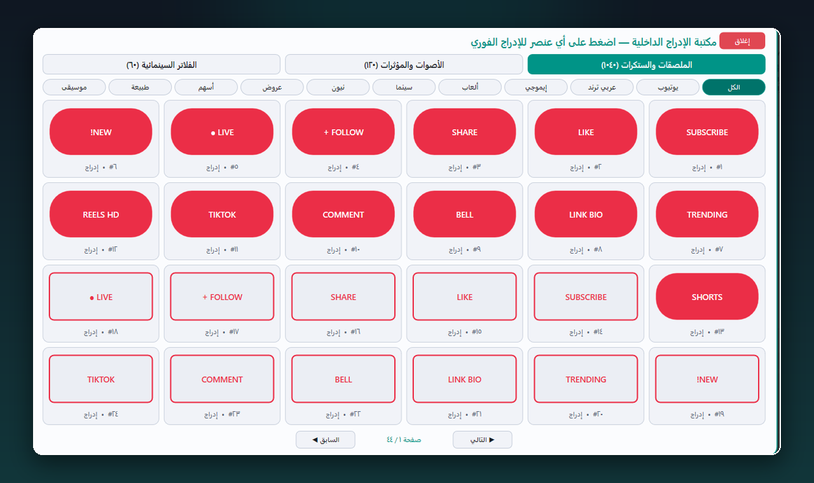
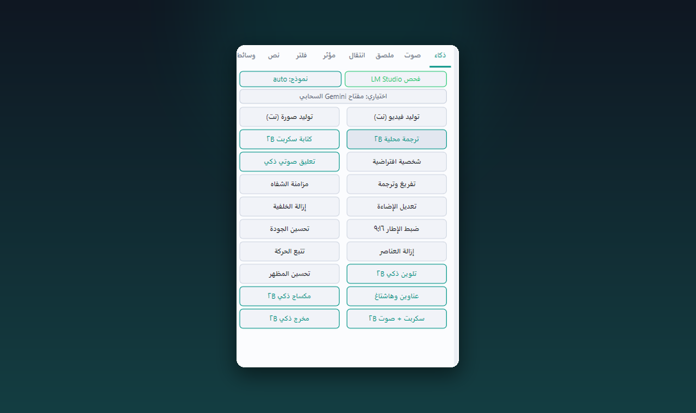

<div align="center">

# 🎬 NovaCut Studio v1.3

**Native C++20 Video, Photo & Audio NLE Studio for Windows — Zero External C++ SDKs, 100% Offline-First**

**استوديو مونتاج الفيديو والصور والصوت الاحترافي لنظام ويندوز بلغة C++20 — بدون مكتبات خارجية، ويعمل أوفلاين بالكامل**

<p>
  
  
  
  <a href="LICENSE"></a>
</p>

<h3>
<a href="#-النسخة-العربية">🇸🇦 العربية</a>
&nbsp;&nbsp;|&nbsp;&nbsp;
<a href="#-english-documentation">🇬🇧 English</a>
</h3>

</div>

---

<div dir="rtl">

# 🇸🇦 النسخة العربية

## 🌟 لماذا NovaCut Studio؟

تتجاوز معظم برامج المونتاج المكتبية حجم **1.5 إلى 4 جيجابايت**، وتفرض تسجيل دخول سحابي واشتراكات شهرية وعلامات مائية. جاء **NovaCut Studio** مبنياً بالكامل من الصفر بنحو **13,700 سطر C++20** اعتماداً على **Windows SDK الأصيل فقط** (`Direct2D`، `DirectWrite`، `WIC`، `Windows Media Foundation`، `WinMM`):

* ⚡ **خفة فائقة (أقل من 2 ميجابايت بعد البناء)**: تشغيل فوري بدون خدمات خلفية ثقيلة.
* 🔒 **خصوصية تامة وعمل أوفلاين 100%**: بدون حساب، بدون علامات مائية، وبدون اتصال إجباري بالإنترنت.
* 🌍 **واجهة عربية (RTL) وإنجليزية أصلية**: دعم كامل للغة العربية مع تبديل فوري بين **الوضع الليلي (Obsidian Dark)** و**الوضع النهاري (Studio Daylight)**.
* 🎛️ **استوديو متكامل في تطبيق واحد**: يجمع المونتاج السينمائي، والتلوين بمراقبات حية، واستوديو الصور الاحترافي، وهندسة الصوت، والتصدير المتقدم، ومكتبة داخلية تضم **1,220 عنصراً**، وجسراً اختيارياً لـ **13 نموذج ذكاء اصطناعي محلي**.

## 📸 لقطات من التطبيق

<table>
  <tr>
    <td align="center"><b>الوضع الليلي (Obsidian Dark)</b><br/></td>
    <td align="center"><b>الوضع النهاري (Studio Daylight)</b><br/></td>
  </tr>
  <tr>
    <td align="center"><b>مكتبة الإدراج الداخلية (1,220 عنصر)</b><br/></td>
    <td align="center"><b>لوحة الذكاء الاصطناعي المحلي</b><br/></td>
  </tr>
</table>

## 📊 مقارنة سريعة: NovaCut Studio مقابل CapCut Desktop

| الميزة | **NovaCut Studio v1.3** | CapCut Desktop |
| ----- | ----- | ----- |
| **حجم البرنامج** | **أقل من 2 ميجابايت** (C++20 أصيل) | أكثر من 1.5 جيجابايت |
| **العمل أوفلاين بدون حساب** | ✅ **100% محلي وبدون تسجيل دخول** | ❌ يتطلب حساباً وسحابة |
| **العلامة المائية والاشتراكات** | ✅ **مجاني بالكامل ومفتوح المصدر (MIT)** | ❌ قيود واشتراكات Pro |
| **مراقبات الفيديو الحية** | ✅ **Histogram + Waveform + Vectorscope + False Color** | ❌ غير متوفرة |
| **استيراد وتصدير 3D LUT** | ✅ **استيراد وتصدير `.cube` بحجم `17×17×17`** | ⚠️ استيراد فقط |
| **فرش تعديل الصور وRAW** | ✅ **10 فرش تفاعلية مباشرة + فك تشفير LibRaw** | ❌ غير متوفرة |
| **تطابق معالجة الصوت بالتصدير** | ✅ **تطابق 100% بين المعاينة والتصدير** | ⚠️ محدود |
| **الذكاء الاصطناعي المحلي** | ✅ **مفتوح مع LM Studio + حزمة 13 نموذجاً أوفلاين** | ❌ سحابي مغلق |

## 🚀 المميزات الكاملة (160+ أداة)

### 1. 🎞️ المونتاج السينمائي والخط الزمني متعدد المسارات

* **مسارات غير محدودة**: إضافة مسارات فيديو (`+V`) ونصوص (`+T`) وصوت (`+A`) مع السحب والإفلات، والمغناطيس (`Snap`)، والحذف مع السحب التلقائي (`Ripple Delete`)، والتراجع/الإعادة، وعلامات التايملاين الذهبية (`M`).
* **أدوات القص الاحترافية**: **J-Cut / L-Cut**، **Slip / Slide Edit**، **دمج المقاطع (Compound Clips)**، **المشاريع المتداخلة (Nested `.ccvs`)**، و**التبديل بين عدة كاميرات (`MultiCam`)**.
* **السرعة والحركة والتتبع**:
  * **منحنى سرعة يدوي (`Custom Speed Ramp`)**: تحكم مستقل في سرعة البداية والوسط والنهاية (`0.25x – 4.0x`) مع تكامل رياضي سلس.
  * **منحنيات حركة الكي فريم**: 5 منحنيات (`Linear`، `Ease In`، `Ease Out`، `Cubic Bezier`، `Bounce`).
  * **التدفق البصري (`Optical Flow`)**: محرك `Block-Matching MCFI` في المعاينة والتصدير مع دعم `Farneback / RIFE`.
  * **تتبع وتثبيت حقيقي**: **تتبع العناصر (`Object Tracking`)**، **تتبع الأسطح (`Planar Homography`)**، **تتبع الكاميرا ثلاثي الأبعاد (`6-DOF`)**، **قناع متحرك مرتبط بالتتبع**، **التثبيت البصري (`Optical Stabilization`)**، **اكتشاف وتقطيع المشاهد تلقائياً**، **تصحيح تشوه العدسة**، و**إصلاح تشوه الحركة (`Rolling Shutter`)**.
* **الأداء والاستقرار**: مولد ملفات **Proxy (`640×360`)** على القرص، **حفظ تلقائي كل 45 ثانية**، **استعادة المسودات**، **سجل النسخ (`Ver++` و`Restore Ver.`)**، ومقارنة **قبل / بعد**.

### 2. 🎨 مكتبة الإدراج الداخلية (`1,220` عنصراً جاهزاً)

مبنية بالكامل داخل التطبيق دون أي موقع خارجي للإدراج بضغطة واحدة:

* **1,040 ملصقاً وستكراً** في 10 تصنيفات شهيرة (*يوتيوب وسوشيال، شارات عربية ترند، تفاعلات وإيموجي، ألعاب، سينما وفلوق، نيون وأشكال، عروض وتسويق، أسهم وإشارات، طبيعة وطقس، موسيقى وتقنية*) × 8 أنماط بصرية.
* **120 مؤثراً صوتياً ولوباً موسيقياً (WAV 48kHz)** تُولّد وتُدرج فوراً على مسار الصوت `A1` (*ووش، بوب، جرس اشتراك، انفجارات سينمائية، برام تريلر، ألعاب، ولوبات لو-فاي وتراب وسينثويف*).
* **60 فلتراً سينمائياً**، و**27 مؤثراً بصرياً إجرائياً** (*تسربات الضوء، الدخان، النار، المطر، الثلج، السوائل، تشويه الصورة، الضوضاء الإجرائية، الانحراف اللوني، خريطة العمق، مجسم 3D، والجسيمات*)، و**19 انتقال فيديو**.

### 3. 🌈 التلوين السينمائي والمراقبات الحية

* **مراقبات Direct2D الحية**: **Histogram (RGB)**، **Waveform (0–100 IRE)**، **Vectorscope (Cb/Cr + خط البشرة)**، وعرض **False Color** لكشف مستويات التعريض.
* **أدوات التلوين**: **توازن أبيض تلقائي**، التعريض، التباين، الإضاءات، الظلال، الأبيض والأسود، التشبع والحيوية، **تحكم كامل بـ 8 نطاقات لونية (8-Band HSL)**، **منحنيات RGB متعددة النقاط**، **عجلات الألوان الثلاثية**، **Split Toning**، **نطاق RAW ACES Filmic**، و**استيراد وتصدير ملفات `.cube` 3D LUT**.

### 4. 🖼️ استوديو الصور والفرش التفاعلية

* **10 فرش تعديل مباشرة على الصورة** مع تحكم بـ **حجم الفرشاة** و**الضغط**: *فرشاة إزالة العيوب (Healing)، الاستنساخ بمصدر يدوي (`Alt+Click`)، الملء الذكي (Content-Aware Fill)، التشكيل (Liquify)، التفتيح والتغميق (Dodge/Burn)، الضبابية والحدة الموضعية، فرشاة التحديد، واللاسو المغناطيسي*.
* **10 أوضاع دمج حقيقية (Blend Modes)**، **أقنعة فيكتور مضلعة**، **أقنعة القص (Clipping Masks)**، **الطبقات الذكية (Smart Objects)**، **تشويه المنظور الحقيقي (`Keystone H/V`)**، **تقليل التشويش الثنائي**، **دعم صور RAW/DNG**، و**التعديل والتصدير الجماعي للصور**.

### 5. 🎧 الهندسة الصوتية (تطابق 100% بين المعاينة والتصدير)

* **معادل 3 نطاقات (Bass / Mid / Treble)**، **ضاغط ديناميكي (Compressor)**، **محدد منع التشوه (Limiter)**، **Biquad 6.5kHz De-Esser** لتخفيف الصفير، **صدى غرف ثلاثي (3-Tap Schroeder Reverb)**، **تكرار صوتي (Echo)**، **توسيع الاستيريو (Mid/Side)**، **توزيع يمين/يسار (Pan)**، **تغيير طبقة الصوت**، **خفض الموسيقى عند الكلام (Audio Ducking)**، **عزل الصوت**، **حذف الصمت تلقائياً**، **طيف صوتي حي من 16 نطاقاً**، **تسجيل صوتي مباشر من المايك**، و**تحويل النص لصوت (TTS)**.

### 6. 📤 التصدير الاحترافي وقائمة التصيير (Render Queue)

* تصدير سريع عبر كرت الشاشة بـ **H.264 / H.265 (HEVC) / AV1**، وتصدير حقيقي لـ **GIF متحرك** و**تسلسل صور PNG** و**خلفية شفافة Alpha PNG**.
* تحكم كامل بـ `480P` حتى `4K UHD`، و`24/30/60 FPS` (**ثابت CFR أو متغير VFR**)، ومعدل بت مخصص (`3–64 Mbps`)، وصوت `44.1/48kHz` (`16/24-bit`)، ومساحات الألوان **`Rec.709 / sRGB / SMPTE DCI-P3 / BT.2020 HDR10 PQ ST.2084`**، و**قائمة مهام تصدير جماعي (`Render Queue`)**، مع دعم **ProRes 422 HQ / AV1 / VP9** عند وضع `ffmpeg.exe` في `CapCutVS_AI/`.

### 7. 🤖 الذكاء الاصطناعي المحلي (LM Studio + حزمة الـ 13 نموذجاً أوفلاين)

* يتصل تلقائياً بمحرك **LM Studio (`127.0.0.1:1234`)** أو **Ollama** دون تجمد للواجهة (في الخلفية) لكتابة السكربت، والسكربت مع التعليق الصوتي، والترجمة المحلية، والتلوين والمكساج الذكي حسب الوصف، والعناوين والهاشتاغات، والمخرج الذكي.
* يضم ملف **`setup_plugins.bat`** و`CapCutVS_AI/ai_worker.py` لربط 13+ نموذجاً محلياً اختيارياً: `Whisper`، `BiRefNet/rembg`، `SAM 2`، `OpenCV`، `Real-ESRGAN`، `RIFE`، `LaMa Inpainting`، `Demucs`، `GFPGAN`، `CodeFormer`، `Depth Anything V2`، `MediaPipe`، `LibRaw`، و`Wav2Lip`.

## 🛠️ طريقة البناء والتشغيل السريع

1. ثبّت **Visual Studio 2022** مع حزمة **Desktop development with C++** (Windows 10/11 SDK).
2. نزّل المستودع وشغّل **`build.bat`** (أو افتح `CapCutVS.sln` وابنِ وضع `Release | x64`).
3. شغّل البرنامج من `bin\Release\CapCutVS.exe`.
4. *(اختياري)* شغّل **`setup_plugins.bat`** لتفعيل النماذج العصبية المحلية، أو شغّل **Local Server** داخل **LM Studio** على المنفذ `1234`.

</div>

---

# 🇬🇧 English Documentation

## 🌟 Why NovaCut Studio?

Most desktop video editors weigh **1.5 GB – 4 GB**, require cloud accounts, lock essential features behind subscriptions, or add export watermarks. **NovaCut Studio** is engineered from scratch in **~13,700 lines of modern C++20** using only the native **Windows SDK** (`Direct2D`, `DirectWrite`, `WIC`, `Windows Media Foundation`, `WinMM`):

* ⚡ **Ultra-Lightweight (< 2 MB compiled binary)** — instant launch with zero background bloatware.
* 🔒 **100% Offline & Private** — no login, no telemetry, no watermarks, no forced cloud uploads.
* 🌍 **Native Arabic (RTL) & English UI** — full DirectWrite RTL support + **Obsidian Dark** & **Studio Daylight** themes.
* 🎛️ **All-in-One Studio** — combines Cinema NLE, Pro Color Grading + Live Scopes, Photo Retouching, Audio DAW, Broadcast Export, 1,220 Built-In Assets, and Optional 13-Model Local AI.

## 📸 Screenshots

<table>
  <tr>
    <td align="center"><b>Obsidian Dark Mode</b><br/></td>
    <td align="center"><b>Studio Daylight Mode</b><br/></td>
  </tr>
  <tr>
    <td align="center"><b>Built-In Asset Library (1,220 Assets)</b><br/></td>
    <td align="center"><b>Local AI Studio Panel</b><br/></td>
  </tr>
</table>

## 🚀 Complete Feature Breakdown (160+ Tools)

### 1. 🎞️ Cinema NLE & Multi-Track Timeline

* **Unlimited Multi-Track Editing**: Dynamic `+T` (Text), `+V` (Video/Image), and `+A` (Audio) tracks with drag-and-drop import, magnetic snap, ripple delete, undo/redo, and gold **Timeline Markers (`M`)**.
* **Precision NLE Cut Tools**: **J-Cut / L-Cut**, **Slip / Slide Edit**, **Compound Clips**, **Nested Sequences (`.ccvs`)**, and **Multi-Camera Switching (`MultiCam`)**.
* **Motion, Speed & Tracking**: **Custom Editable Speed Ramp (`Start / Mid / End`, `0.25x – 4.0x`)**, **5 Keyframe Motion Curves (`Linear / EaseIn / EaseOut / Cubic Bezier / Bounce`)**, **Optical Flow (MCFI + Farneback/RIFE)**, **Object Tracking**, **Planar Surface Tracking (Homography)**, **3D Camera Tracking (6-DOF)**, **Motion Tracking Mask**, **Optical Stabilization**, **Dual-Metric Scene Cut Detection**, **Lens Distortion Correction**, and **Rolling Shutter Correction**.
* **Workflow & Stability**: **640×360 Disk Proxy Generator**, **45-Second Auto-Save**, **Draft Recovery**, **Version History (`Ver++` & `Restore Ver.`)**, **Custom Presets**, **Before/After Compare**, and **Touchpad Pinch-to-Zoom**.

### 2. 🎨 Built-In Asset Library (`1,220` Assets)

100% built into the native Direct2D interface for 1-click timeline insertion:

* **1,040 Stickers & Badges** across 10 creator categories × 8 visual styles.
* **120 Synthesized 48kHz Stereo WAV Sound Effects & Music Loops** inserted directly onto Track `A1`.
* **60 Cinema Color Filters**, **27 Procedural VFX** (*Light Leaks, Smoke, Fire, Rain, Snow, Liquid, Displacement, Fractal Noise, Chromatic Aberration, Depth Map, 3D Cube, Particles, Glitch, CRT, VHS, Lens Flare, Neon*), and **19 Video Transitions**.

### 3. 🌈 Pro Color Grading & Live Scopes

* **Live Direct2D Video Scopes**: **RGB Histogram**, **Waveform Monitor (0–100 IRE)**, **Vectorscope (Cb/Cr + Skin-Tone Line)**, **All Scopes**, and **Cinema IRE False Color** exposure monitor.
* **Color Engine**: **Auto White Balance**, Exposure, Contrast, Highlights, Shadows, Whites, Blacks, Saturation, Vibrance, **Full 8-Band HSL**, **Multi-Point RGB Curves**, **3-Way Color Wheels**, **Split Toning**, **RAW ACES Filmic Tone**, and **`.cube` 3D LUT Import & Export (`17×17×17`)**.

### 4. 🖼️ Pro Photo & Retouching Studio

* **10 Direct-on-Canvas Brushes** (with adjustable **Size** & **Pressure**): *Healing Brush, Clone Stamp (`Alt+Click` manual source), Content-Aware Fill, Liquify, Dodge, Burn, Blur, Sharpen, Selection Brush, Magnetic Lasso*.
* **10 True Blend Modes**, **Vector Polygon Masks**, **Clipping Masks**, **Smart Object Layers**, **Projective Perspective Keystone Warp (`H/V`)**, **Bilateral Denoise**, **RAW/DNG Import**, **Batch Edit**, and **Batch PNG Export**.

### 5. 🎧 Pro Audio DAW (100% Preview & Export Parity)

* **3-Band EQ**, **Dynamic Compressor**, **Brickwall Limiter**, **2nd-Order Biquad 6.5kHz De-Esser**, **3-Tap Schroeder Reverb**, **250ms Echo**, **Mid/Side Stereo Width**, **Pan**, **Pitch Shift**, **Noise Gate**, **Audio Ducking**, **Vocal Isolation**, **Auto Silence Trimming**, **1-Click Audio Restoration**, **Beat Detection**, **Live 16-Band Spectrum**, **Mic Voiceover Recorder**, and **Windows SAPI TTS**.

### 6. 📤 Broadcast Export & Multi-Job Render Queue

* Native GPU **H.264 / H.265 (HEVC) / AV1**, plus **Animated GIF**, **PNG Sequence**, and **Alpha Transparent PNG**.
* `480P–4K UHD`, `24/30/60 FPS` (**CFR & VFR**), **Custom Bitrate (`3–64 Mbps`)**, **Audio `44.1/48kHz` (`16/24-bit`)**, **Color Spaces (`Rec.709`, `sRGB`, `SMPTE 3×3 DCI-P3`, `BT.2020 HDR10 PQ ST.2084`)**, **Smart HDR**, and **Batch Render Queue**.
* Optional **ProRes 422 HQ / AV1 / VP9 / MOV** transcoding when a full `ffmpeg.exe` is placed in `CapCutVS_AI/`.

### 7. 🤖 Offline Multi-Task Local AI & 13-Model Plugin Bridge

* Auto-connects to **LM Studio (`127.0.0.1:1234`)** or **Ollama** on non-blocking background threads for Script Writing, Script + Voiceover, Subtitle Translation, Smart Color Grading, Smart Audio Mastering, Viral Packs, and Director Reviews.
* Optional offline Python sidecar (`setup_plugins.bat` + `CapCutVS_AI/ai_worker.py`): `Whisper`, `BiRefNet/rembg`, `SAM 2`, `OpenCV`, `Real-ESRGAN`, `RIFE`, `LaMa Inpainting`, `Demucs`, `GFPGAN`, `CodeFormer`, `Depth Anything V2`, `MediaPipe`, `LibRaw`, `Wav2Lip`, and `SadTalker`.

## 🏗️ Architecture

```
NovaCut-Studio/
├── src/
│   ├── MainWindow.h / .cpp       # Direct2D + DirectWrite UI, Scopes, 1,220 Asset Hub, Async AI
│   ├── MediaEngine.h / .cpp      # Video/Photo Pipeline, 27 VFX, Optical Flow, Trackers, Brushes
│   ├── AudioEngine.h / .cpp      # Real-Time Multi-Track Mixer, Biquad DSP, Spectrum, Mic & TTS
│   ├── FFmpegExporter.h / .cpp   # Native Media Foundation GPU Exporter + Full Audio DSP Parity
│   ├── TimelineEngine.h / .cpp   # Multi-Track NLE State, Undo/Redo, J/L-Cut, Slip/Slide, MultiCam
│   ├── AICloudBridge.h / .cpp    # LM Studio / Ollama / Whisper / Neural Sidecar / Gemini Bridge
│   ├── ProjectIO.h / .cpp        # .ccvs JSON Project Serialization & Version Snapshots
│   └── Types.h                   # Core Data Models, Keyframe Easing, Speed Ramp Integral
├── docs/screenshots/             # Application Screenshots (Dark, Light, Asset Library, AI Panel)
├── CapCutVS_AI/ai_worker.py      # Optional Local Python Neural AI Sidecar (13+ Models)
├── .github/workflows/            # Automated GitHub Actions Windows Release x64 CI Build
├── build.bat                     # 1-Click Visual Studio 2022 Release x64 Build Script
└── setup_plugins.bat             # Optional 1-Click Local Neural AI Plugins Installer
```

## 🛠️ Quick Build (Windows 10/11 x64)

1. Install **Visual Studio 2022** with the **Desktop development with C++** workload (Windows 10/11 SDK).
2. Clone the repository and run **`build.bat`** (or open `CapCutVS.sln` and build `Release | x64`).
3. Launch **`bin\Release\CapCutVS.exe`**.

## ⌨️ Keyboard Shortcuts | اختصارات لوحة المفاتيح

| Shortcut | English | العربية |
| ----- | ----- | ----- |
| `Space` | Play / Pause | تشغيل / إيقاف |
| `Ctrl + B` | Split clip at playhead | قص المقطع عند المؤشر |
| `Ctrl + Z` / `Ctrl + Y` | Undo / Redo | تراجع / إعادة |
| `Ctrl + D` | Duplicate selected clip | تكرار المقطع المحدد |
| `Ctrl + S` / `Ctrl + F` | Save Project / Search FX | حفظ المشروع / البحث |
| `K` / `M` / `B` | Keyframe / Mute / Before-After | كيفريم / كتم / قبل وبعد |
| `Alt + Click` | Set Clone Stamp Source | تحديد مصدر الاستنساخ يدوياً |
| `F1` / `F11` / `Esc` | Shortcuts / Fullscreen / Close | الاختصارات / ملء الشاشة / إغلاق |

## 📄 License

Distributed under the **MIT License**. See [LICENSE](LICENSE) for details.
